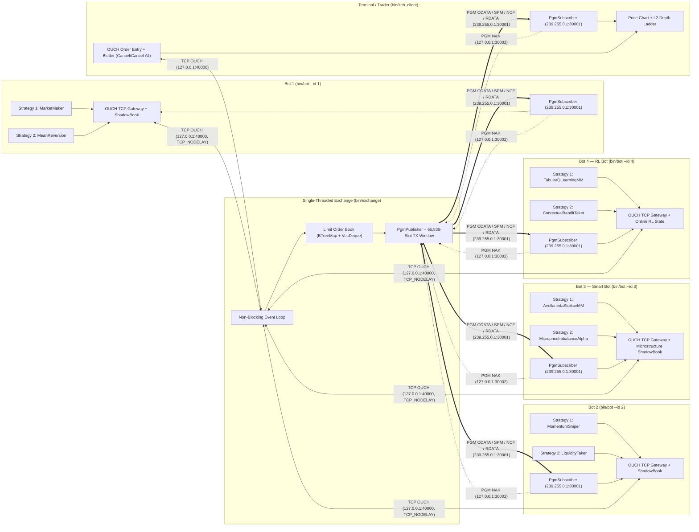

# `itch-ouch-sim` — Single-Threaded PGM ITCH / TCP OUCH Exchange, Multi-Strategy Bots & Real-Time GUI Client

A high-performance, cross-platform (Windows & Linux/macOS) Rust implementation of a **single-threaded price-time priority matching engine**, **three multi-strategy trading bots (including a quantitative microstructure smart bot)**, and an **interactive real-time desktop GUI trading terminal** communicating over **NASDAQ OUCH 5.0 (TCP)** and **PGM-encapsulated NASDAQ ITCH 5.0 (IPv4 Reliable Multicast)**.

---

## Architecture Overview



---

## Key Components

| Module / Binary | Description |
| :--- | :--- |
| `src/protocol.rs` | Fixed-size, Big-Endian (network byte order) binary wire frames for **OUCH Inbound** (`EnterOrder`, `CancelOrder` — 22 B), **OUCH Outbound** (`OrderAccepted`, `OrderExecuted`, `OrderCanceled` — 30 B), and **ITCH 5.0** (`OrderAdded`, `OrderExecuted`, `OrderDeleted` — 30 B). Prices use 4-decimal fixed-point representation (`PRICE_SCALE = 10_000`). |
| `src/pgm.rs` | **RFC 3208 UDP-Encapsulated Pragmatic General Multicast (PGM)** layer (52-byte frames): supports `PGM_SPM` (`0x00`) heartbeats, `PGM_ODATA` (`0x04`) original multicast data, `PGM_RDATA` (`0x05`) repair retransmissions from a 65,536-slot circular transmit window, `PGM_NAK` (`0x08`) gap requests, and `PGM_NCF` (`0x09`) NAK confirmations. Fully cross-platform: uses `SO_REUSEADDR` + `SO_REUSEPORT` on POSIX/macOS and Winsock2 (`ws2_32`) on Windows with loopback multicast interface setup. |
| `src/exchange.rs` | Single-threaded non-blocking limit order book and matching engine (`ExchangeServer`). Zero locks or mutex contention on the matching path. |
| `src/bot.rs` | Multi-threaded bot client (`spawn_bot`) with a dedicated PGM ITCH receiver thread (maintaining a local `ShadowBook` with microprice, multi-level Order Book Imbalance, EWMA volatility, and order-flow toxicity analytics), a TCP OUCH reader thread (tracking real-time inventory and mark-to-market PnL), a serialized TCP OUCH writer thread (`mpsc::Receiver<OuchInbound>`), and **2 concurrent strategy threads**. |
| `src/bin/exchange.rs` | Standalone Exchange Server executable (`exchange`). |
| `src/bin/bot.rs` | Standalone Trading Bot executable (`bot`). |
| `src/bin/sim.rs` | All-in-one simulation runner launching the standalone exchange and all four bots. |
| `src/bin/itch_client.rs` | Real-time **desktop GUI trading terminal** built with `eframe` / `egui` and `egui_plot`, featuring live price charts, L2 market depth ladder, interactive OUCH order submission/cancellation, order blotter with MTM PnL tracking, public Time & Sales tape, and a CLI fallback mode (`--cli`). |

---

## Real-Time GUI Client (`itch_client`)

The `itch_client` application provides an institutional-grade monitoring and trading interface:

1. **Real-Time Price Chart (`egui_plot`)**:
   - Streaming **Last Trade Price**, **Mid Price**, and **Best Bid / Best Ask** envelope.
   - Color-coded Buy (green) and Sell (red) execution dots.
   - Configurable time horizons (`5s`, `15s`, `30s`, `60s`, `All`) with interactive pan/zoom.
2. **Level-2 Market Depth Ladder**:
   - Depth ladder showing price levels, shares, and cumulative volume with proportional depth bars.
   - Real-time Bid/Ask order book imbalance meter.
   - **Click-to-Pick**: Clicking any level in the depth ladder automatically copies that price into the Order Entry ticket.
3. **Interactive OUCH Order Entry**:
   - Toggle **BUY** / **SELL** with quantity chips (`50`, `100`, `200`, `500`) and steppers.
   - Price adjustment with `[-0.01]` / `[+0.01]` and quick anchors (`Bid`, `Mid`, `Ask`).
   - Live order notional calculation and instant limit order submission via TCP OUCH.
4. **Order Blotter & Position Tracker**:
   - Live inventory position, cash balance, and continuous Mark-to-Market (MTM) PnL.
   - Active orders table with per-order **Cancel** buttons and a **Cancel All Open Orders** button.
5. **Time & Sales (Trade Tape)**:
   - Full public market execution stream showing timestamp, sequence number, order reference, side, shares, and execution price.
6. **1-Click Built-in Simulator**:
   - Includes a **`▶ Start Built-in Sim`** button in the header to launch an embedded exchange + 4 trading bots and auto-connect OUCH with zero configuration.
7. **🤖 Bot PnL Leaderboard & Equal Starting Capital (`$100,000.00`)**:
   - Every bot is initialized with an equal, fixed **`$100,000.00`** starting capital (`INITIAL_BOT_CAPITAL_DOLLARS = 100_000`), enforced by the bot's OUCH order gateway so no bot can buy or short beyond its available capital/equity.
   - Live ranking of the built-in bots by mark-to-market PnL, showing **Start Cap (`$100,000.00`)**, **Current Equity**, **MTM PnL**, **Available Cash**, **Position**, **Fills**, and **Orders**, plus a PnL-over-time chart per bot.
   - When the built-in sim is stopped, the tab opens automatically and keeps showing each bot's final result.

---

## Bot Strategies

1. **Bot 1 (`--id 1`)**:
   * **Market Maker**: Quotes passive two-sided spreads ($\pm \$0.0025$) around the local shadow book mid-price, dynamically skewing quotes based on current inventory.
   * **Mean Reversion**: Monitors top-of-book deviations from the $\$100.0000$ anchor fair value and aggressively fades spikes exceeding $\$0.0030$.
2. **Bot 2 (`--id 2`)**:
   * **Momentum Sniper**: Tracks aggressive buy vs. sell execution volume imbalance from the ITCH feed and snipes top-of-book liquidity in the direction of order flow.
   * **Liquidity Taker**: Periodically sweeps top-of-book quotes to generate continuous tape activity.
3. **Bot 3 — Smart Quantitative Bot (`--id 3`)**:
   * **Avellaneda-Stoikov Adaptive Market Maker (`AvellanedaStoikovMM`)**: Computes a continuous reservation price $r(s, q) = s_{\text{fair}} - q \cdot \gamma \cdot \sigma$ around the composite microstructure fair value, dynamically scales half-spreads with EWMA realized volatility $\sigma$ and order-flow toxicity, applies asymmetric adverse-selection protection against informed flow, preserves queue priority when quotes are within tolerance, and enforces hard inventory caps.
   * **Microprice & Order-Book Imbalance Alpha (`MicropriceImbalanceAlpha`)**: Combines volume-weighted top-of-book microprice, 5-level exponentially weighted Order Book Imbalance (OBI), and EWMA signed trade flow to snipe mispriced top-of-book liquidity or passively peg/improve the BBO to unwind inventory.
4. **Bot 4 — Online Reinforcement Learning Bot (`--id 4`)**:
   * **Tabular Q-Learning Market Maker (`TabularQLearningMM`)**: Encodes the market into 45 discrete states ($5\text{ inventory buckets} \times 3\text{ OBI regimes} \times 3\text{ volatility/toxicity regimes}$) and selects among 6 quoting actions (tight/moderate/wide symmetric, bid-skewed, ask-skewed, or inventory-flattening peg) using decaying $\epsilon$-greedy exploration and online Bellman TD(0) updates driven by inventory-penalized mark-to-market PnL rewards.
   * **Contextual UCB1 Execution Bandit (`ContextualBanditTaker`)**: Partitions order-book imbalance and order-flow toxicity into 9 discrete contexts and learns online across 4 execution arms (`Hold`, `Snipe Ask`, `Hit Bid`, `Passive BBO Peg`) using Upper Confidence Bound (UCB1) exploration with recency-weighted reward updates.

---

## Quick Start

### 1. Build Release Binaries

```bash
cargo build --release
```

### 2. Launch the Desktop GUI Client

```bash
cargo run --release --bin itch_client
```
> **Tip**: Click **`▶ Start Built-in Sim`** in the top bar to immediately spin up the Exchange and trading bots, or run standalone processes as shown below.

### 3. Run the Combined Headless Simulation (`sim`)

```bash
# Run for 2000ms (default)
cargo run --release --bin sim -- 2000
```

### 4. Run Standalone Processes in Separate Terminals

**Terminal 1 — Start the Single-Threaded Exchange Server:**
```bash
cargo run --release --bin exchange -- \
  --ouch 127.0.0.1:40000 \
  --mcast-group 239.255.0.1 \
  --mcast-port 30001 \
  --nak 127.0.0.1:30002
```

**Terminal 2 — Start the Real-Time GUI (or CLI terminal mode):**
```bash
# Desktop GUI:
cargo run --release --bin itch_client

# Or Headless Terminal Mode:
cargo run --release --bin itch_client -- --cli --depth 10
```

**Terminal 3 — Start Bot 1 (Market Maker + Mean Reversion):**
```bash
cargo run --release --bin bot -- --id 1 --duration-ms 5000
```

**Terminal 4 — Start Bot 2 (Momentum Sniper + Liquidity Taker):**
```bash
cargo run --release --bin bot -- --id 2 --duration-ms 5000
```

**Terminal 5 — Start Bot 3 (Smart Avellaneda-Stoikov MM + Microprice/OBI Alpha):**
```bash
cargo run --release --bin bot -- --id 3 --duration-ms 5000
```

**Terminal 6 — Start Bot 4 (Reinforcement Learning Tabular Q-Learning MM + Contextual UCB1 Bandit):**
```bash
cargo run --release --bin bot -- --id 4 --duration-ms 5000
```
