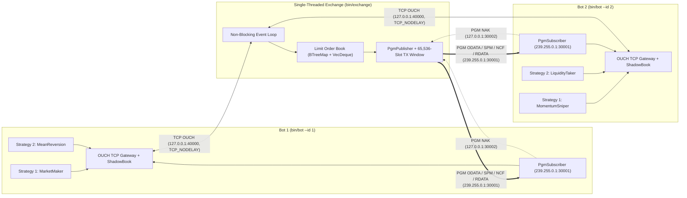

# `itch-ouch-sim` — Single-Threaded PGM ITCH / TCP OUCH Exchange & Multi-Strategy Trading Bots

A zero-dependency, low-latency Rust implementation of a **single-threaded price-time priority matching engine** and **two multi-strategy trading bots** communicating over **NASDAQ OUCH 5.0 (TCP)** and **PGM-encapsulated NASDAQ ITCH 5.0 (IPv4 Reliable Multicast)**.

---

## Architecture Overview



---

## Key Components

| Module / Binary | Description |
| :--- | :--- |
| `src/protocol.rs` | Fixed-size, Big-Endian (network byte order) binary wire frames for **OUCH Inbound** (`EnterOrder`, `CancelOrder` — 22 B), **OUCH Outbound** (`OrderAccepted`, `OrderExecuted`, `OrderCanceled` — 30 B), and **ITCH 5.0** (`OrderAdded`, `OrderExecuted`, `OrderDeleted` — 30 B). Prices use 4-decimal fixed-point representation (`PRICE_SCALE = 10_000`). |
| `src/pgm.rs` | **RFC 3208 UDP-Encapsulated Pragmatic General Multicast (PGM)** layer (52-byte frames): supports `PGM_SPM` (`0x00`) heartbeats, `PGM_ODATA` (`0x04`) original multicast data, `PGM_RDATA` (`0x05`) repair retransmissions from a 65,536-slot circular transmit window, `PGM_NAK` (`0x08`) gap requests, and `PGM_NCF` (`0x09`) NAK confirmations. Uses `SO_REUSEADDR` + `SO_REUSEPORT` + `IP_MULTICAST_IF` so multiple bot processes on the same host share the multicast feed. |
| `src/exchange.rs` | Single-threaded non-blocking limit order book and matching engine (`ExchangeServer`). Zero locks or mutex contention on the matching path. |
| `src/bot.rs` | Multi-threaded bot client (`spawn_bot`) with a dedicated PGM ITCH receiver thread (maintaining a local `ShadowBook`), a TCP OUCH reader thread (tracking real-time inventory and mark-to-market PnL), a serialized TCP OUCH writer thread (`mpsc::Receiver<OuchInbound>`), and **2 concurrent strategy threads**. |
| `src/bin/exchange.rs` | Standalone Exchange Server executable (`exchange`). |
| `src/bin/bot.rs` | Standalone Trading Bot executable (`bot`). |
| `src/bin/sim.rs` | All-in-one simulation runner launching the standalone exchange and both bots. |

---

## Bot Strategies

1. **Bot 1 (`--id 1`)**:
   * **Market Maker**: Quotes passive two-sided spreads ($\pm \$0.0025$) around the local shadow book mid-price, dynamically skewing quotes based on current inventory.
   * **Mean Reversion**: Monitors top-of-book deviations from the $\$100.0000$ anchor fair value and aggressively fades spikes exceeding $\$0.0030$.
2. **Bot 2 (`--id 2`)**:
   * **Momentum Sniper**: Tracks aggressive buy vs. sell execution volume imbalance from the ITCH feed and snipes top-of-book liquidity in the direction of order flow.
   * **Liquidity Taker**: Periodically sweeps top-of-book quotes to generate continuous tape activity.

---

## Quick Start

### 1. Build Release Binaries

```bash
cargo build --release
```

### 2. Run the Combined Simulation (`sim`)

```bash
# Run for 2000ms (default)
cargo run --release --bin sim -- 2000
```

### 3. Run Standalone Processes in Separate Terminals

**Terminal 1 — Start the Single-Threaded Exchange Server:**
```bash
cargo run --release --bin exchange -- \
  --ouch 127.0.0.1:40000 \
  --mcast-group 239.255.0.1 \
  --mcast-port 30001 \
  --nak 127.0.0.1:30002
```

**Terminal 2 — Start Bot 1 (Market Maker + Mean Reversion):**
```bash
cargo run --release --bin bot -- --id 1 --duration-ms 5000
```

**Terminal 3 — Start Bot 2 (Momentum Sniper + Liquidity Taker):**
```bash
cargo run --release --bin bot -- --id 2 --duration-ms 5000
```
